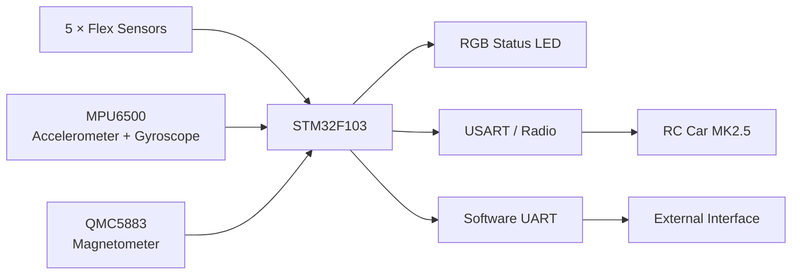

<table align="right">
  <tr>
    <td><b>🇬🇧 English</b></td>
    <td><a href="./README_RU.md">🇷🇺 Русский</a></td>
  </tr>
</table>

# 🧤 Glove MK2 — Gesture-Based HMI Controller

A wearable human-machine interface based on **STM32F103**, five finger flex sensors and inertial sensing.

The glove converts finger state and hand orientation into control data for external devices.

Its main application is gesture control of the [RC Car MK2.5](https://github.com/suneids/Car), but the firmware also includes a keyboard-style finger-mask mode and a compass visualization mode.

<p align="center">
  
</p>

---

## ⚙️ System Architecture



---

## 🖐️ Finger Sensing

Five analog flex sensors are sampled simultaneously through the STM32 ADC subsystem.

The acquisition chain is:

```text
5 × Flex Sensors
      ↓
ADC
      ↓
DMA1 Channel 1
      ↓
adc_fingers[5]
```

DMA continuously transfers ADC samples directly into memory, so the application does not need to poll every ADC channel manually.

Each finger is converted into a binary state using an individually calibrated threshold.

The resulting states are packed into a 5-bit mask:

```text
bit 0 → finger 1
bit 1 → finger 2
bit 2 → finger 3
bit 3 → finger 4
bit 4 → finger 5
```

This mask is used both for gesture input and for calculating vehicle speed in Car Controller Mode.

---

## 🧭 Hand Orientation

Hand motion is measured with an **MPU6500 accelerometer/gyroscope**.

The firmware reads the sensor using a 14-byte I²C burst containing acceleration and angular-rate data.

Pitch estimation uses a complementary filter:

```text
angle =
    0.96 × (previous_angle + gyro_rate × dt)
  + 0.04 × accelerometer_angle
```

This combines:

- short-term gyroscope responsiveness;
- long-term accelerometer stability.

Roll is currently derived directly from the accelerometer and is used as the steering input for the RC car.

---

## 🎮 Operating Modes

The glove firmware is organized around several independent activities.

A short press of the mode button cycles between them.

### 🚗 Car Controller Mode

The glove directly controls the [RC Car MK2.5](https://github.com/suneids/Car).

Control mapping:

```text
Hand roll
    ↓
Steering angle

Number of bent fingers
    ↓
Vehicle speed

Hand pitch
    ↓
Forward / reverse
```

Each bent finger contributes approximately **20%** to the requested speed.

Five fingers therefore provide five discrete speed levels up to 100%.

Tilting the hand beyond the configured pitch threshold reverses the sign of the speed command.

---

### ⌨️ Keyboard / Finger-Mask Mode

In this mode the current five-finger state is packed into a bit mask and periodically transmitted through software UART.

This provides a compact generic gesture representation that can be interpreted by another controller or PC-side application.

Example:

```text
00000 → all fingers in one state
00101 → fingers 1 and 3 active
11111 → all five active
```

The firmware itself does not assign keyboard characters to individual gestures; it outputs the finger-state mask for higher-level interpretation.

---

### 🧭 Compass Mode

The glove also includes a **QMC5883 magnetometer**.

Compass Mode:

- reads the magnetic field vector over I²C;
- calculates heading;
- maps heading to RGB color;
- continuously updates the status LED.

The color wheel represents orientation approximately as:

```text
North → Blue
East  → Green
South → Red
West  → Purple
```

with smooth transitions between directions.

---

## 🔧 Interactive Calibration

A long press of the mode button starts the complete calibration sequence.

Calibration is performed directly on the device without recompiling firmware.

### IMU calibration

The firmware collects multiple gyroscope samples and calculates zero-rate offsets.

Currently the calibration routine averages **200 samples**.

---

### Flex sensor calibration

During calibration the firmware records the minimum and maximum ADC values observed for every finger.

For each channel:

```text
threshold = (minimum + maximum) / 2
```

This compensates for:

- different sensor resistance;
- finger geometry;
- mounting position;
- mechanical differences between sensors.

---

### Magnetometer calibration

The firmware records minimum and maximum magnetic-field values while the glove is rotated.

From these measurements it calculates:

- X offset;
- Y offset;
- axis scaling correction.

This reduces hard-iron offset and axis-scale error before heading visualization.

---

## 📡 RC Car Protocol

Car Controller Mode uses the same compact packet format understood by the RC Car firmware:

```text
0xFE | Steering | Speed | XOR
```

| Byte | Field | Description |
|---:|---|---|
| 0 | Header | `0xFE` |
| 1 | Steering | Hand-orientation-derived steering command |
| 2 | Speed | Signed speed command |
| 3 | Checksum | `Steering XOR Speed` |

This allows the glove to communicate directly with the vehicle without an additional translation layer.

---

## 💡 RGB Feedback

A three-channel RGB LED provides immediate visual feedback.

It is driven through PWM and is used for:

- operating-mode indication;
- animated mode colors;
- calibration feedback;
- compass visualization;
- fault indication.

The firmware also includes a custom `HardFault_Handler()` that switches the RGB LED to a dedicated error color if the MCU enters a HardFault state.

---

## 🔧 Firmware

The firmware runs on **STM32F103** and is written in C using CMSIS and custom register-level drivers.

Used peripherals include:

- ADC;
- DMA;
- I²C;
- USART;
- software UART;
- PWM;
- GPIO;
- SysTick.

The project uses the custom STM32 driver library as a Git submodule:

[**STM32 Low-Level Drivers**](https://github.com/suneids/HAL_STM32F103C6T6)

---

## 🔌 Hardware

| Component | Function |
|---|---|
| STM32F103 | Main controller |
| 5 × flex sensors | Finger state detection |
| MPU6500 | Accelerometer + gyroscope |
| QMC5883 | Magnetic heading |
| RGB LED | Status / mode / compass indication |
| Radio / UART interface | External communication |

---

## 🧩 Electronics

The repository contains the glove schematic together with separate interface sheets for:

- flex sensor inputs;
- RGB LED / external circuitry.

Both Altium and KiCad project files are present in the repository.

---

## 📁 Repository Structure

```text
Glove/
├── app/
│   └── firmware/
│       ├── STM32F103 firmware
│       └── custom HAL submodule
│
├── electronics/
│   ├── Glove_Alrium/
│   │   └── Altium schematics
│   │
│   └── kicad_scheme/
│       └── KiCad schematics
│
├── docs/
│   └── specs/
│       └── glove.jpg
│
├── 3d models/
├── README.md
└── README_RU.md
```

---

## ✅ Implemented

- [x] STM32F103 firmware
- [x] Five-channel flex sensing
- [x] ADC acquisition with DMA
- [x] Finger-state bit mask
- [x] MPU6500 accelerometer / gyroscope interface
- [x] Complementary-filter pitch estimation
- [x] QMC5883 magnetometer interface
- [x] Car Controller Mode
- [x] Keyboard / finger-mask mode
- [x] Compass Mode
- [x] Interactive flex calibration
- [x] Gyroscope offset calibration
- [x] Magnetometer calibration
- [x] RGB status indication
- [x] Custom RC Car communication protocol
- [x] HardFault visual indication
- [x] Altium / KiCad schematic design
