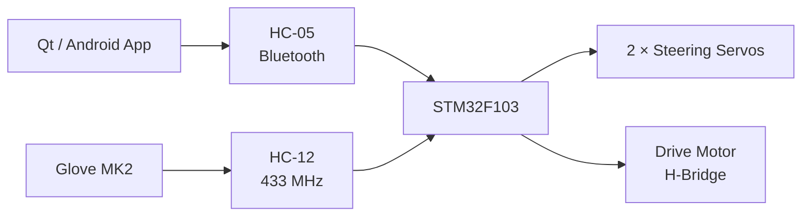

<table align="right">
  <tr>
    <td><b>🇬🇧 English</b></td>
    <td><a href="./README_RU.md">🇷🇺 Русский</a></td>
  </tr>
</table>

# 🚗 RC Car MK2.5

A remotely controlled robotic car built around an **STM32F103** with two interchangeable control interfaces:

- a Qt/Android application over Bluetooth;
- the custom [Glove MK2](https://github.com/suneids/Glove) wearable controller over radio.

The firmware is written in C using CMSIS and custom register-level STM32 drivers.

The platform combines embedded control, RF communication, custom electronics and software steering compensation in a single robotic system.

---

## ⚙️ System Architecture



The STM32 firmware can switch between the two control sources at runtime.

---

## 🎮 Control Modes

### 📱 Mobile application

The Android controller is written in **Qt/C++**.

It implements:

- Bluetooth Classic communication through RFCOMM;
- custom on-screen joystick;
- conversion of joystick coordinates into steering angle and signed speed;
- periodic transmission of control packets.

Joystick displacement determines vehicle speed, while joystick direction determines steering angle.

Moving the joystick below the center generates a negative speed command for reverse motion.

---

### 🧤 Glove control

The second control mode accepts commands from the [Glove MK2](https://github.com/suneids/Glove).

The glove converts hand orientation and finger state into the same steering/speed packet format used by the mobile application.

This allows the car firmware to use a common motion-control layer regardless of the physical controller.

---

## 📡 Communication Protocol

Both control interfaces use the same compact 4-byte packet:

```text
0xFE | Steering | Speed | XOR
```

| Byte | Field | Description |
|---:|---|---|
| 0 | Header | `0xFE` start byte |
| 1 | Steering | Requested steering angle |
| 2 | Speed | Signed velocity command |
| 3 | Checksum | `Steering XOR Speed` |

The firmware scans the incoming stream for the `0xFE` header and verifies the XOR checksum before executing the command.

Invalid packets are discarded.

---

## 🧠 Firmware Architecture

The main control loop performs four stages:

```text
Receive packet
      ↓
Validate checksum
      ↓
Steering compensation
      ↓
PWM generation
```

The STM32 receives commands either from:

- hardware USART — mobile/Bluetooth mode;
- software UART — glove/radio mode.

A physical button switches the active control source.

---

## 🛞 Software Ackermann Steering Compensation

The front wheels are controlled by **two independent steering servos**.

Instead of sending exactly the same angle to both wheels, the firmware applies individual center offsets and an additional correction to the inside wheel during a turn.

Conceptually:

```text
Requested steering angle
          ↓
Left / right mechanical offsets
          ↓
Inside-wheel additional steering
          ↓
Independent servo angles
```

This produces a software approximation of **Ackermann steering**, where the inner front wheel turns through a larger angle than the outer wheel.

The implementation is intentionally empirical rather than a full geometric Ackermann solver: correction values are calibrated for the actual steering mechanism.

---

## ⚡ Motor and Steering Control

The STM32 generates PWM signals for:

- left steering servo;
- right steering servo;
- two H-bridge control inputs for the drive motor.

Signed speed commands are converted into motor direction and PWM magnitude.

```text
speed > 0 → forward
speed < 0 → reverse
```

Steering commands are normalized from the protocol angle range into the calibrated PWM range of each servo.

---

## 🔧 Embedded Firmware

The firmware runs on an **STM32F103C8T6 / Cortex-M3**.

It uses a custom register-level driver library rather than STM32 HAL:

[**STM32 Low-Level Drivers**](https://github.com/suneids/HAL_STM32F103C6T6)

Used peripherals and modules include:

- GPIO;
- TIM / PWM;
- USART;
- software UART;
- SysTick;
- button/event handling.

The driver library is included as a Git submodule.

---

## 🔋 Electronics

Main hardware:

| Component | Role |
|---|---|
| STM32F103 | Main controller |
| HC-05 | Bluetooth control |
| HC-12 | Radio link to Glove MK2 |
| MP2315 | Buck converter |
| 2 × servo | Independent front-wheel steering |
| H-bridge | Drive motor control |

The electronics were designed in **Altium Designer**.

The repository contains the schematic, PCB project and generated schematic documentation.

---

## 📱 Qt / Android Application

The mobile controller is implemented in Qt/C++.

Its custom joystick calculates:

```text
dx, dy
  ↓
atan2()
  ↓
Steering angle
```

while joystick displacement determines speed.

The application then generates the same binary packet understood by the STM32:

```text
0xFE | angle | signed speed | XOR
```

Bluetooth communication uses Qt Bluetooth and an RFCOMM socket.

---

## 📁 Repository Structure

```text
Car/
├── app/
│   ├── android_/
│   │   └── Qt/C++ mobile controller
│   │
│   └── firmware/
│       ├── STM32F103 firmware
│       └── custom HAL submodule
│
├── electronics/
│   └── Car_Altium/
│       ├── schematic
│       ├── PCB
│       └── documentation
│
├── 3d models/
├── docs/
├── README.md
└── README_RU.md
```

---

## ✅ Implemented

- [x] STM32F103 bare-metal firmware
- [x] Bluetooth control through HC-05
- [x] Radio control from Glove MK2
- [x] Runtime control-mode switching
- [x] Custom binary protocol
- [x] XOR packet validation
- [x] Forward and reverse motor control
- [x] Independent left/right steering servos
- [x] Software Ackermann steering compensation
- [x] Mechanical steering calibration
- [x] Qt/Android joystick controller
- [x] Custom PCB design in Altium
- [x] MP2315-based power conversion
