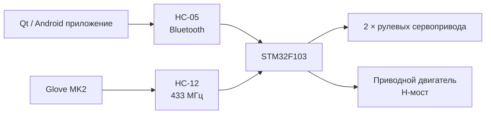

<table align="right">
  <tr>
    <td><a href="./README.md">🇬🇧 English</a></td>
    <td><b>🇷🇺 Русский</b></td>
  </tr>
</table>

# 🚗 RC Car MK2.5

Радиоуправляемая робототехническая машинка на **STM32F103** с двумя взаимозаменяемыми интерфейсами управления:

- Qt/Android-приложение через Bluetooth;
- носимый контроллер [Glove MK2](https://github.com/suneids/Glove) через радиоканал.

Прошивка написана на C с использованием CMSIS и собственных низкоуровневых драйверов STM32.

Проект объединяет embedded-управление, радиосвязь, собственную электронику и программную компенсацию рулевой геометрии.

---

## ⚙️ Архитектура системы



Прошивка STM32 позволяет переключаться между двумя источниками управления во время работы.

---

## 🎮 Режимы управления

### 📱 Мобильное приложение

Контроллер для Android написан на **Qt/C++**.

Реализованы:

- Bluetooth Classic через RFCOMM;
- собственный экранный джойстик;
- преобразование координат джойстика в угол руления и знаковую скорость;
- периодическая передача управляющих пакетов.

Удаление джойстика от центра определяет скорость, а его направление — угол руления.

Перемещение джойстика ниже центра формирует отрицательную скорость для движения назад.

---

### 🧤 Управление перчаткой

Второй режим принимает команды от [Glove MK2](https://github.com/suneids/Glove).

Перчатка преобразует ориентацию кисти и состояние пальцев в тот же формат команд угла и скорости, который используется мобильным приложением.

Благодаря этому прошивка машинки использует общий слой управления движением независимо от физического контроллера.

---

## 📡 Протокол связи

Оба интерфейса управления используют один компактный пакет из четырёх байт:

```text
0xFE | Steering | Speed | XOR
```

| Байт | Поле | Назначение |
|---:|---|---|
| 0 | Header | Стартовый байт `0xFE` |
| 1 | Steering | Требуемый угол руления |
| 2 | Speed | Знаковая команда скорости |
| 3 | Checksum | `Steering XOR Speed` |

Прошивка ищет в потоке стартовый байт `0xFE` и проверяет XOR-контрольную сумму перед выполнением команды.

Некорректные пакеты отбрасываются.

---

## 🧠 Архитектура прошивки

Основной цикл управления состоит из четырёх этапов:

```text
Приём пакета
      ↓
Проверка checksum
      ↓
Коррекция руления
      ↓
Формирование PWM
```

STM32 принимает команды через:

- аппаратный USART — режим мобильного приложения / Bluetooth;
- программный UART — режим перчатки / радиоканала.

Активный источник управления переключается физической кнопкой.

---

## 🛞 Программная Ackermann-компенсация

Передние колёса управляются **двумя независимыми сервоприводами**.

Вместо передачи одинакового угла обоим колёсам прошивка использует индивидуальные поправки механического нуля и дополнительный доворот внутреннего колеса при повороте.

Принцип работы:

```text
Заданный угол
      ↓
Поправки левого / правого механического нуля
      ↓
Дополнительный доворот внутреннего колеса
      ↓
Независимые углы двух сервоприводов
```

Таким образом программно реализуется приближение к **геометрии Аккермана**: внутреннее переднее колесо поворачивается сильнее внешнего.

Реализация использует эмпирические коэффициенты, откалиброванные под реальную рулевую механику, а не полный геометрический расчёт радиуса поворота.

---

## ⚡ Управление двигателем и рулением

STM32 формирует PWM для:

- левого рулевого сервопривода;
- правого рулевого сервопривода;
- двух управляющих входов H-моста приводного двигателя.

Знаковая команда скорости определяет направление и величину PWM:

```text
speed > 0 → движение вперёд
speed < 0 → движение назад
```

Команда угла руления преобразуется из диапазона протокола в откалиброванный PWM-диапазон каждого сервопривода.

---

## 🔧 Embedded-прошивка

Прошивка работает на **STM32F103C8T6 / Cortex-M3**.

Вместо STM32 HAL используется собственная библиотека драйверов с прямой работой с регистрами:

[**STM32 Low-Level Drivers**](https://github.com/suneids/HAL_STM32F103C6T6)

Используются:

- GPIO;
- TIM / PWM;
- USART;
- программный UART;
- SysTick;
- обработка кнопок и событий.

Библиотека драйверов подключена к проекту как Git submodule.

---

## 🔋 Электроника

Основные компоненты:

| Компонент | Назначение |
|---|---|
| STM32F103 | Главный контроллер |
| HC-05 | Bluetooth-управление |
| HC-12 | Радиоканал от Glove MK2 |
| MP2315 | Понижающий преобразователь |
| 2 × servo | Независимое руление передних колёс |
| H-мост | Управление приводным двигателем |

Электроника разработана в **Altium Designer**.

В репозитории находятся принципиальная схема, проект PCB и сгенерированная документация схемы.

---

## 📱 Qt / Android приложение

Мобильный контроллер реализован на Qt/C++.

Собственный экранный джойстик преобразует координаты:

```text
dx, dy
  ↓
atan2()
  ↓
Угол руления
```

а расстояние от центра задаёт скорость.

После этого приложение формирует тот же бинарный пакет, который понимает STM32:

```text
0xFE | angle | signed speed | XOR
```

Bluetooth-связь реализована через Qt Bluetooth и RFCOMM socket.

---

## 📁 Структура репозитория

```text
Car/
├── app/
│   ├── android_/
│   │   └── мобильное приложение Qt/C++
│   │
│   └── firmware/
│       ├── прошивка STM32F103
│       └── submodule собственной HAL
│
├── electronics/
│   └── Car_Altium/
│       ├── принципиальная схема
│       ├── PCB
│       └── документация
│
├── 3d models/
├── docs/
├── README.md
└── README_RU.md
```

---

## ✅ Реализовано

- [x] Bare-metal прошивка STM32F103
- [x] Bluetooth-управление через HC-05
- [x] Радиоуправление от Glove MK2
- [x] Переключение режима управления во время работы
- [x] Собственный бинарный протокол
- [x] XOR-проверка пакетов
- [x] Управление движением вперёд и назад
- [x] Независимое управление двумя рулевыми сервоприводами
- [x] Программная Ackermann-компенсация
- [x] Калибровка рулевой механики
- [x] Qt/Android приложение с джойстиком
- [x] Собственная PCB в Altium
- [x] Питание на основе MP2315
