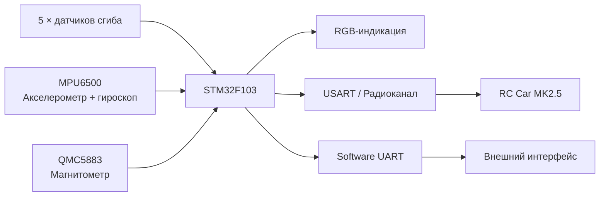

<table align="right">
  <tr>
    <td><a href="./README.md">🇬🇧 English</a></td>
    <td><b>🇷🇺 Русский</b></td>
  </tr>
</table>

# 🧤 Glove MK2 — жестовый HMI-контроллер

Носимый человеко-машинный интерфейс на базе **STM32F103**, пяти датчиков сгиба пальцев и инерциальных датчиков.

Перчатка преобразует состояние пальцев и ориентацию кисти в управляющие данные для внешних устройств.

Основное применение — жестовое управление [RC Car MK2.5](https://github.com/suneids/Car), однако прошивка также содержит режим передачи маски пальцев и режим электронного компаса.

<p align="center">
  
</p>

---

## ⚙️ Архитектура системы



---

## 🖐️ Определение состояния пальцев

Пять аналоговых датчиков сгиба считываются через АЦП STM32.

Цепочка получения данных:

```text
5 × датчиков сгиба
        ↓
       ADC
        ↓
 DMA1 Channel 1
        ↓
 adc_fingers[5]
```

DMA непрерывно переносит результаты преобразования АЦП непосредственно в память, поэтому основной код не должен вручную опрашивать каждый канал.

Для каждого пальца используется индивидуально откалиброванный порог.

После сравнения с порогами состояние пяти пальцев упаковывается в 5-битную маску:

```text
bit 0 → палец 1
bit 1 → палец 2
bit 2 → палец 3
bit 3 → палец 4
bit 4 → палец 5
```

Маска используется как для распознавания жестового состояния, так и для задания скорости машинки.

---

## 🧭 Ориентация кисти

Движение кисти измеряется с помощью **MPU6500 — акселерометра и гироскопа**.

Прошивка считывает 14 байт данных одним I²C burst-запросом.

Угол Pitch рассчитывается complementary filter:

```text
angle =
    0.96 × (previous_angle + gyro_rate × dt)
  + 0.04 × accelerometer_angle
```

Таким образом объединяются:

- быстрая реакция гироскопа;
- долговременная стабильность акселерометра.

Roll в текущей реализации рассчитывается непосредственно по акселерометру и используется для управления рулением машинки.

---

## 🎮 Режимы работы

Прошивка разделена на несколько независимых activity.

Короткое нажатие кнопки переключает текущий режим.

### 🚗 Режим управления машинкой

Перчатка напрямую управляет [RC Car MK2.5](https://github.com/suneids/Car).

Управление распределено следующим образом:

```text
Roll кисти
    ↓
Угол руления

Количество согнутых пальцев
    ↓
Скорость

Pitch кисти
    ↓
Вперёд / назад
```

Каждый согнутый палец добавляет примерно **20%** скорости.

Таким образом пять пальцев формируют пять ступеней скорости вплоть до 100%.

При наклоне кисти за заданный порог Pitch знак скорости меняется, переводя машинку в движение назад.

---

### ⌨️ Режим маски пальцев

В этом режиме состояние пяти пальцев упаковывается в битовую маску и периодически передаётся через программный UART.

Это создаёт универсальное компактное представление жеста, которое может использовать другой контроллер или приложение на ПК.

Например:

```text
00000 → одно состояние всех пальцев
00101 → активны пальцы 1 и 3
11111 → активны все пять
```

Сама прошивка перчатки не назначает конкретные символы клавиатуры каждому жесту — она передаёт маску состояния для дальнейшей интерпретации.

---

### 🧭 Режим компаса

В перчатке также используется **магнитометр QMC5883**.

В режиме компаса прошивка:

- считывает вектор магнитного поля по I²C;
- вычисляет направление;
- преобразует направление в цвет;
- обновляет RGB-индикатор.

Цветовой круг приблизительно соответствует направлениям:

```text
Север  → синий
Восток → зелёный
Юг     → красный
Запад  → фиолетовый
```

Между основными направлениями формируются плавные цветовые переходы.

---

## 🔧 Интерактивная калибровка

Долгое нажатие кнопки запускает полный цикл калибровки.

Калибровка выполняется непосредственно устройством и не требует изменения прошивки.

### Калибровка IMU

Прошивка собирает серию измерений гироскопа и рассчитывает смещение нуля.

В текущей реализации усредняется **200 измерений**.

---

### Калибровка датчиков сгиба

Во время калибровки прошивка запоминает минимальные и максимальные значения АЦП для каждого пальца.

Для каждого канала:

```text
threshold = (minimum + maximum) / 2
```

Это позволяет компенсировать:

- различия сопротивления датчиков;
- геометрию руки;
- особенности монтажа;
- различия между отдельными сенсорами.

---

### Калибровка магнитометра

Во время вращения перчатки прошивка сохраняет минимальные и максимальные значения магнитного поля.

По ним рассчитываются:

- смещение X;
- смещение Y;
- коэффициент масштабирования осей.

Это уменьшает влияние постоянного магнитного смещения и различий масштаба измерительных осей.

---

## 📡 Протокол RC Car

Режим управления машинкой использует тот же компактный пакет, который понимает прошивка RC Car:

```text
0xFE | Steering | Speed | XOR
```

| Байт | Поле | Назначение |
|---:|---|---|
| 0 | Header | `0xFE` |
| 1 | Steering | Команда руления из ориентации кисти |
| 2 | Speed | Знаковая команда скорости |
| 3 | Checksum | `Steering XOR Speed` |

Благодаря общему протоколу перчатка может напрямую передавать управляющие данные машинке без дополнительного промежуточного преобразования.

---

## 💡 RGB-индикация

Трёхканальный RGB-светодиод используется для непосредственной обратной связи с пользователем.

Управление яркостью выполняется через PWM.

Индикация используется для:

- отображения режима работы;
- динамической цветовой индикации;
- процесса калибровки;
- отображения направления компаса;
- индикации ошибок.

В прошивке также реализован собственный `HardFault_Handler()`, который переводит RGB-индикатор в отдельный цвет ошибки при возникновении HardFault.

---

## 🔧 Прошивка

Прошивка работает на **STM32F103** и написана на C с использованием CMSIS и собственных низкоуровневых драйверов.

Используемая периферия:

- ADC;
- DMA;
- I²C;
- USART;
- программный UART;
- PWM;
- GPIO;
- SysTick.

Собственная библиотека STM32-драйверов подключена как Git submodule:

[**STM32 Low-Level Drivers**](https://github.com/suneids/HAL_STM32F103C6T6)

---

## 🔌 Аппаратная часть

| Компонент | Назначение |
|---|---|
| STM32F103 | Главный контроллер |
| 5 × flex sensor | Определение состояния пальцев |
| MPU6500 | Акселерометр + гироскоп |
| QMC5883 | Измерение направления |
| RGB LED | Индикация режима / состояния / компаса |
| Radio / UART | Внешняя связь |

---

## 🧩 Электроника

В репозитории находятся принципиальная схема перчатки и отдельные схемные листы для:

- подключения датчиков сгиба;
- RGB LED и внешней обвязки.

Присутствуют исходники проектов как в Altium, так и в KiCad.

---

## 📁 Структура репозитория

```text
Glove/
├── app/
│   └── firmware/
│       ├── прошивка STM32F103
│       └── submodule собственной HAL
│
├── electronics/
│   ├── Glove_Alrium/
│   │   └── схемы Altium
│   │
│   └── kicad_scheme/
│       └── схемы KiCad
│
├── docs/
│   └── specs/
│       └── glove.jpg
│
├── 3d models/
├── README.md
└── README_RU.md
```

---

## ✅ Реализовано

- [x] Прошивка STM32F103
- [x] Пять каналов датчиков сгиба
- [x] Считывание ADC через DMA
- [x] 5-битная маска состояния пальцев
- [x] Работа с MPU6500
- [x] Complementary filter для Pitch
- [x] Работа с QMC5883
- [x] Режим управления машинкой
- [x] Режим передачи маски пальцев
- [x] Режим компаса
- [x] Интерактивная калибровка flex-сенсоров
- [x] Калибровка смещения гироскопа
- [x] Калибровка магнитометра
- [x] RGB-индикация
- [x] Общий протокол связи с RC Car
- [x] Визуальная индикация HardFault
- [x] Схемы Altium / KiCad
